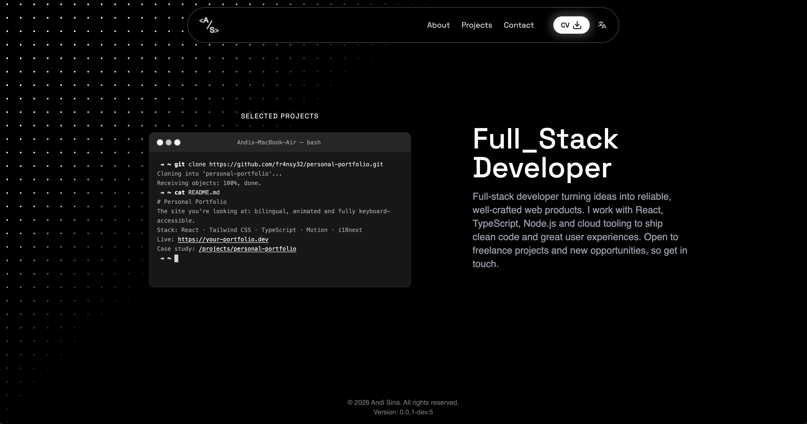
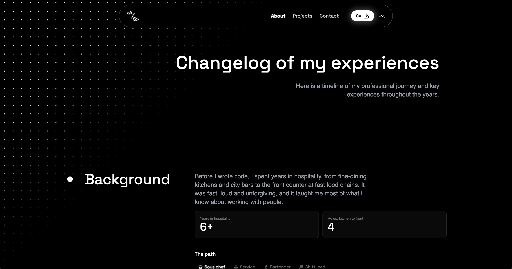
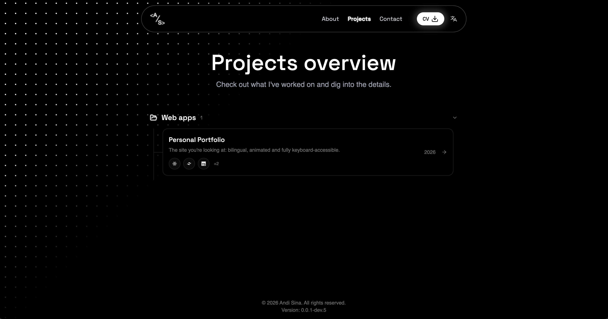
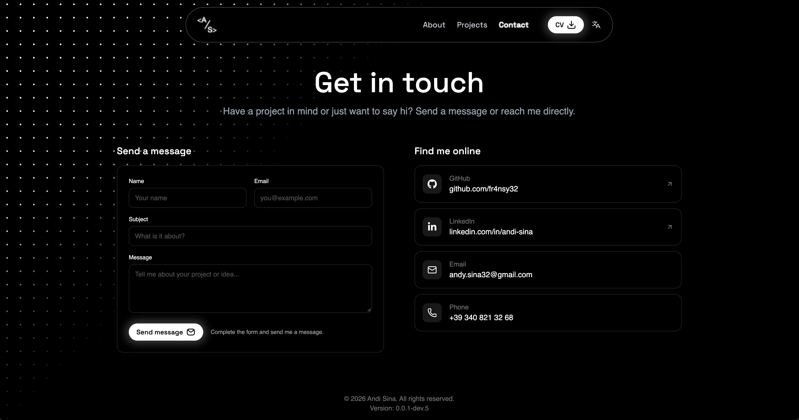

# Andi Sina | Personal Portfolio

My personal portfolio website, built with **React** and **Vite** and deployed on **Cloudflare**. It is fully bilingual (🇮🇹 Italian / 🇬🇧 English), accessible, and includes a contact form that delivers messages straight to my Discord through a Cloudflare serverless function.

🔗 **Live site:** [your-domain.com](https://your-domain.com)

---

## 📸 Preview

| Home | About |
| --- | --- |
|  |  |

| Projects | Contact |
| --- | --- |
|  |  |

---

## ✨ Features

- **Full internationalization**: complete Italian and English translations powered by i18next, split by page and fully typed.
- **Discord contact form**: messages submitted through the form are delivered directly to a Discord channel through a Discord webhook.
- **Secure by design**: the webhook URL is never exposed to the client. The form talks to a **Cloudflare serverless function** (`/api/contact`), which holds the secrets and forwards the message to Discord.
- **Language-aware CV download**: the download button serves the CV that matches the currently selected language (Italian or English).
- **Reduced motion support**: every animated component respects the user's `prefers-reduced-motion` setting.
- **Interactive sections**: a terminal-style home page with carousel, an about timeline, and a project explorer with a tree view and detail pages with galleries.
- **Lottie micro-interactions**: animated buttons for download, send, reload and the home hero.
- **Modern UI**: animations and polished components built with Motion, Aceternity UI and shadcn/ui.
- **Fast and edge-deployed**: built with Vite and served from Cloudflare's global network.

---

## 🛠️ Tech Stack

| Area | Technology |
| --- | --- |
| Framework | [React](https://react.dev/) |
| Build tool | [Vite](https://vitejs.dev/) |
| Language | [TypeScript](https://www.typescriptlang.org/) |
| Styling | [Tailwind CSS](https://tailwindcss.com/) |
| UI components | [shadcn/ui](https://ui.shadcn.com/), [Aceternity UI](https://ui.aceternity.com/) |
| Animations | [Motion](https://motion.dev/), [Lottie](https://lottiefiles.com/) |
| i18n | [i18next](https://www.i18next.com/) + [react-i18next](https://react.i18next.com/) |
| Backend / API | [Cloudflare Pages Functions](https://developers.cloudflare.com/pages/functions/) (Workers runtime) |
| Integrations | [Discord Webhooks](https://discord.com/developers/docs/resources/webhook) |
| Hosting | [Cloudflare](https://www.cloudflare.com/) |
| Linting | [ESLint](https://eslint.org/) |

---

## 🌍 Internationalization

All user-facing text lives in translation files, so nothing is hard-coded in the components. Translations are organized by namespace, one file per page, for each language:

```
src/locales/
├── en/
│   ├── about.json
│   ├── common.json
│   ├── contacts.json
│   ├── home.json
│   ├── projects.json
│   └── index.ts
├── it/
│   └── ...            # same structure as en
└── index.ts
```

Translation keys are typed through `src/i18n.d.ts`, so a missing or misspelled key is caught at compile time. The language can be switched at any time from the navbar toggle.

To add a new language, create a new folder inside `src/locales/` with the same namespaces and register it in `src/i18n.ts`.

### Language-aware CV download

The CV button picks the file matching the active language:

```
src/assets/pdf/
├── Andi_Sina_CV_Eng.pdf
└── Andi_Sina_CV_Ita.pdf
```

---

## ♿ Accessibility and Reduced Motion

Animations are never forced on the user. When the operating system or browser has **"reduce motion"** enabled, all animated components (Motion, Aceternity UI and Lottie) tone down or disable their animations, while keeping the content and layout identical. Shared animation presets live in `src/lib/motion-variants.ts`, which keeps this behavior consistent across the whole site.

---

## 💬 Contact Form and Discord Integration

The contact form sends messages to Discord without ever exposing the webhook URL to the browser:

```
┌─────────┐   POST /api/contact   ┌──────────────────────┐   Discord API   ┌─────────┐
│ Browser │ ────────────────────▶ │ Cloudflare Function  │ ──────────────▶ │ Discord │
└─────────┘                       └──────────────────────┘                 └─────────┘
                                   (holds secrets,
                                    validates input)
```

1. The user fills in and submits the form (`src/pages/contacts/form.tsx`).
2. The frontend service (`src/services/contact.ts`) sends a `POST` request to `/api/contact`.
3. The function in `functions/api/contact.ts` validates the payload and posts the message to a private Discord channel through the webhook, whose URL is stored as an encrypted secret on Cloudflare.
4. I receive the message on Discord in real time.

### Secrets (server-side)

| Secret | Description |
| --- | --- |
| `DISCORD_WEBHOOK_URL` | Discord webhook URL of the channel that receives the messages |

This secret is configured as an encrypted environment variable in Cloudflare. It is only available to the serverless function and is never committed to the repository or bundled into the frontend.

---

## 🔐 Environment Variables

Two kinds of variables are used:

| Type | Example | Where it lives | Exposed to the browser? |
| --- | --- | --- | --- |
| Secret | `DISCORD_WEBHOOK_URL` | Cloudflare (encrypted) | No |
| UI variables | `VITE_CONTACT_EMAIL`, `VITE_GITHUB_URL`, `VITE_LINKEDIN_URL` | `.env` / Cloudflare build settings | Yes |

The UI variables hold my public contact details (email, social links, and so on) shown across the site. Vite only exposes variables prefixed with `VITE_`, and they are embedded in the built bundle, so only public information belongs there. Anything sensitive stays in the Cloudflare secrets.

These are configured as encrypted environment variables in Cloudflare and are never committed to the repository.

---

## 📁 Project Structure

```
.
├── functions/
│   ├── api/
│   │   └── contact.ts          # Cloudflare function: contact endpoint → Discord
│   └── tsconfig.json
├── public/                     # Favicons, apple-touch-icon, Open Graph image
├── src/
│   ├── assets/
│   │   ├── img/                # Portfolio screenshots
│   │   ├── lottie/             # Lottie animations (download, home, reload, send)
│   │   ├── pdf/                # CVs (Italian and English)
│   │   └── svg/                # Personal logo
│   ├── components/             # Shared components (lottie button, tabs, tech badge, motion header)
│   │   └── ui/                 # shadcn/ui and Aceternity UI components
│   ├── data/                   # Static data (projects, tech stack)
│   ├── layout/                 # App shell: navbar, language toggle, dot background
│   ├── lib/                    # Utilities, motion variants, tab ids
│   ├── locales/                # i18next translations (en, it)
│   ├── pages/
│   │   ├── home/               # Terminal-style hero with carousel
│   │   ├── about/              # Intro, background, education, experience, timeline
│   │   ├── projects/           # Project tree, project details, gallery
│   │   ├── contacts/           # Contact form and links
│   │   ├── error.tsx
│   │   └── not-found.tsx
│   ├── routes/                 # Route definitions and names
│   ├── services/               # API calls (contact form)
│   ├── types/                  # Shared TypeScript types
│   ├── App.tsx
│   ├── i18n.ts                 # i18next configuration
│   ├── i18n.d.ts               # Typed translation keys
│   └── main.tsx
├── components.json             # shadcn/ui configuration
├── eslint.config.js
├── index.html
├── tsconfig.*.json
└── vite.config.ts
```

---

## 📄 License

This project is released under the [MIT License](./LICENSE).

The content (text, images, CV) is personal and not covered by the license. Please don't reuse it without permission.

---

## 📬 Contact

- Website: [your-domain.com](https://your-domain.com)
- GitHub: [@fr4nsy32](https://github.com/fr4nsy32)
- LinkedIn: [andi-sina](https://linkedin.com/in/andi-sina)
