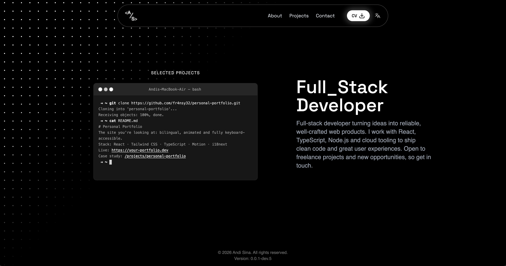
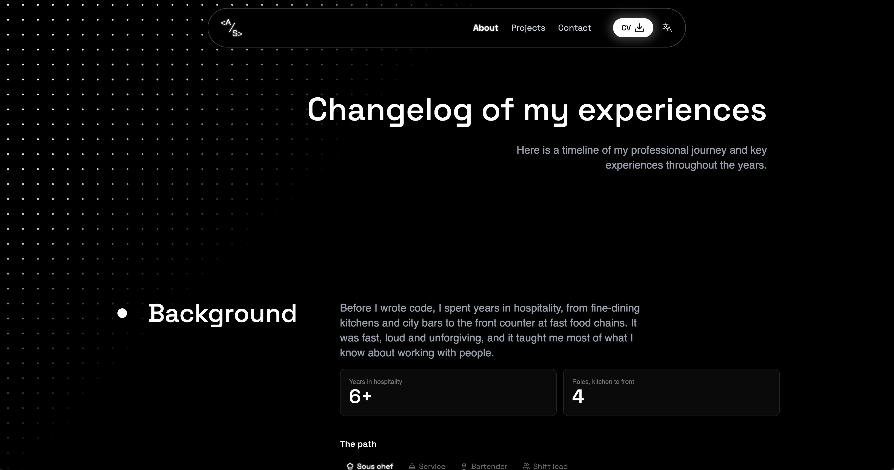
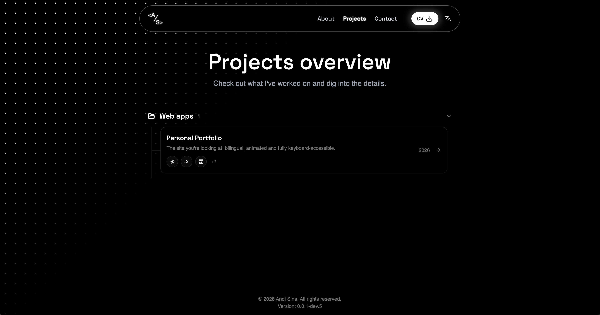
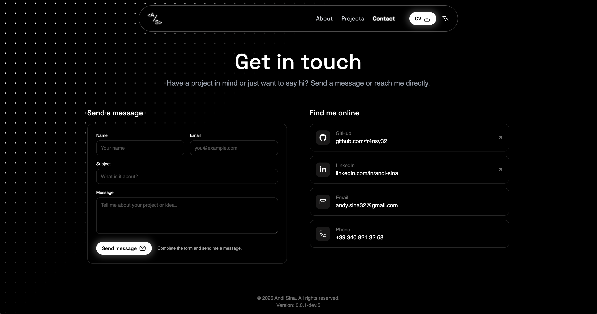

# Andi Sina | Personal Portfolio

My personal portfolio website, built with **React** and **Next.js**, deployed on **Vercel**. It is fully bilingual (🇮🇹 Italian / 🇬🇧 English), accessible, and includes a contact form that delivers messages straight to my Discord through a Next.js API route.

🔗 **Live site:** [as-web.dev](https://as-web.dev)

---

## 📸 Preview

| Home | About |
| --- | --- |
|  |  |

| Projects | Contact |
| --- | --- |
|  |  |

---

## ✨ Features

- **Full internationalization**: complete Italian and English translations powered by i18next, split by page and fully typed.
- **Discord contact form**: messages submitted through the form are delivered directly to a Discord channel through a Discord webhook.
- **Secure by design**: the webhook URL is never exposed to the client. The form talks to a **Next.js route handler** (`/api/contact`), which holds the secrets and forwards the message to Discord.
- **Language-aware CV download**: the download button serves the CV that matches the currently selected language (Italian or English).
- **Reduced motion support**: every animated component respects the user's `prefers-reduced-motion` setting.
- **Interactive sections**: a terminal-style home page with carousel, an about timeline, and a project explorer with a tree view and detail pages with galleries.
- **Lottie micro-interactions**: animated buttons for download, send, reload and the home hero.
- **Modern UI**: animations and polished components built with Motion, Aceternity UI and shadcn/ui.
- **Fast delivery**: the frontend and contact API are deployed together on Vercel.

---

## 🛠️ Tech Stack

| Area | Technology |
| --- | --- |
| Framework | [React](https://react.dev/) + [Next.js App Router](https://nextjs.org/) |
| CSS processing | [PostCSS](https://postcss.org/) + [Tailwind CSS PostCSS plugin](https://tailwindcss.com/docs/installation/using-postcss) |
| Language | [TypeScript](https://www.typescriptlang.org/) |
| Styling | [Tailwind CSS](https://tailwindcss.com/) |
| UI components | [shadcn/ui](https://ui.shadcn.com/), [Aceternity UI](https://ui.aceternity.com/) |
| Animations | [Motion](https://motion.dev/), [Lottie](https://lottiefiles.com/) |
| i18n | [i18next](https://www.i18next.com/) + [react-i18next](https://react.i18next.com/) |
| Backend / API | [Next.js Route Handlers](https://nextjs.org/docs/app/getting-started/route-handlers) |
| Integrations | [Discord Webhooks](https://discord.com/developers/docs/resources/webhook) |
| Hosting | [Vercel](https://vercel.com/) |
| Domain registration / DNS | [Cloudflare](https://www.cloudflare.com/) |
| Linting | [ESLint](https://eslint.org/) |

---

## 🌍 Internationalization

All user-facing text lives in translation files, so nothing is hard-coded in the components. Translations are organized by namespace, one file per page, for each language:

```
locales/
├── en/
│   ├── about.json
│   ├── common.json
│   ├── contacts.json
│   ├── home.json
│   ├── projects.json
│   └── index.ts
├── it/
│   └── ...            # same structure as en
└── index.ts
```

Translation keys are typed through `i18n.d.ts`, so a missing or misspelled key is caught at compile time. The language can be switched at any time from the navbar toggle.

To add a new language, create a new folder inside `locales/` with the same namespaces and register it in `i18n.ts`.

### Language-aware CV download

The CV button picks the file matching the active language:

```
public/assets/pdf/
├── andi_sina_cv_eng.pdf
└── andi_sina_cv_ita.pdf
```

---

## ♿ Accessibility and Reduced Motion

Animations are never forced on the user. When the operating system or browser has **"reduce motion"** enabled, all animated components (Motion, Aceternity UI and Lottie) tone down or disable their animations, while keeping the content and layout identical. Shared animation presets live in `lib/motion-variants.ts`, which keeps this behavior consistent across the whole site.

---

## 💬 Contact Form and Discord Integration

The contact form sends messages to Discord without ever exposing the webhook URL to the browser:

```
┌─────────┐   POST /api/contact   ┌──────────────────────┐   Discord API   ┌─────────┐
│ Browser │ ────────────────────▶ │ Next.js API Route    │ ──────────────▶ │ Discord │
└─────────┘                       └──────────────────────┘                 └─────────┘
                                   (holds secrets,
                                    validates input)
```

1. The user fills in and submits the form (`features/contacts/form.tsx`).
2. The frontend service (`services/contact.ts`) sends a `POST` request to `/api/contact`.
3. The route handler in `app/api/contact/route.ts` validates the payload and posts the message to a private Discord channel through the webhook, whose URL is stored in a server-side environment variable.
4. I receive the message on Discord in real time.

### Secrets (server-side)

| Secret | Description |
| --- | --- |
| `DISCORD_WEBHOOK_URL` | Discord webhook URL of the channel that receives the messages |

This secret is configured as a server-side environment variable in Vercel for the deployed application, or in `.env.local` for local Next.js development. It is only available to the server-side contact endpoint and is never committed to the repository or bundled into the frontend.

---

## 🔐 Environment Variables

Two kinds of variables are used:

| Type | Example | Where it lives | Exposed to the browser? |
| --- | --- | --- | --- |
| Secret | `DISCORD_WEBHOOK_URL` | `.env.local` / Vercel environment settings | No |
| UI variables | `NEXT_PUBLIC_EMAIL`, `NEXT_PUBLIC_PHONE_NUMBER`, `NEXT_PUBLIC_GITHUB_USER`, `NEXT_PUBLIC_LINKEDIN_USER` | `.env.local` / Vercel environment settings | Yes |

The UI variables hold my public contact details (email, social links, and so on) shown across the site. Next.js only exposes variables prefixed with `NEXT_PUBLIC_`, and they are embedded in the built bundle, so only public information belongs there. Anything sensitive stays in server-side environment variables.

These are configured in Vercel environment settings for the live deployment or locally in `.env.local` for Next.js development and are never committed to the repository.

---

## 📁 Project Structure

```
.
├── app/                        # Next.js App Router routes and layouts
│   ├── api/contact/route.ts     # Contact endpoint → Discord
│   ├── about/page.tsx
│   ├── contacts/page.tsx
│   ├── projects/
│   │   ├── page.tsx
│   │   └── [slug]/page.tsx
│   ├── layout.tsx              # Root layout and metadata
│   ├── providers.tsx           # Client-side language provider
│   ├── page.tsx                # Home route
│   ├── error.tsx
│   └── not-found.tsx
├── assets/
│   ├── img/                    # Portfolio screenshots
│   ├── lottie/                 # Lottie animations (download, home, reload, send)
│   └── svg/                    # Personal logo
├── components/                 # Shared components (lottie button, tabs, tech badge, motion header)
│   └── ui/                     # shadcn/ui and Aceternity UI components
├── data/                       # Static data (projects, tech stack)
├── features/
│   ├── home/                   # Terminal-style hero with carousel
│   ├── about/                  # Intro, background, education, experience, timeline
│   ├── projects/               # Project tree, project details, gallery
│   ├── contacts/               # Contact form and links
│   ├── error.tsx
│   └── not-found.tsx
├── layout/                     # App shell: navbar, language toggle, dot background
├── lib/                        # Utilities, motion variants, tab ids
├── locales/                    # i18next translations (en, it)
├── public/                     # Favicons, apple-touch-icon, Open Graph image
│   └── assets/pdf/             # CVs (Italian and English)
├── routes/                     # Shared route names
├── services/                   # API calls (contact form)
├── types/                      # Shared TypeScript types
├── app-styles.css              # Global styles and Tailwind theme
├── components.json             # shadcn/ui configuration
├── eslint.config.js
├── i18n.ts                     # i18next configuration
├── i18n.d.ts                   # Typed translation keys
├── next.config.ts
├── postcss.config.mjs
└── tsconfig.json
```

---

## 🔄 Migration to Next.js

The project originally used Vite, React Router, and Cloudflare Pages Functions. It now uses Next.js App Router, with the frontend and contact API in the same application.

- **Routing**: root-level `app/` defines the existing routes: `/`, `/about`, `/projects`, `/projects/[slug]`, and `/contacts`. Page components moved from `src/pages/` to `features/`, retaining their internal component organization.
- **Components and UI**: component markup, styling, translations, and animation assets are preserved. Navigation uses Next.js links, and interactive components use `"use client"` where needed.
- **Contact API**: `functions/api/contact.ts` became `app/api/contact/route.ts`. The form still sends requests to `/api/contact`, and the Discord webhook stays server-side.
- **Styles**: Tailwind uses `@tailwindcss/postcss` instead of the Vite plugin because Next.js processes the CSS through PostCSS. The existing utilities and theme remain in place.
- **Assets and configuration**: source folders live at the repository root, CVs are served from `public/assets/pdf/`, and public environment variables use `NEXT_PUBLIC_` instead of `VITE_`. The old `.dev.vars` configuration is no longer used.

To run the migrated project locally, configure the variables listed above in `.env.local`, then run:

```sh
npm ci
npm run dev
```

The development server serves both the frontend and `/api/contact`. Run `npm run lint` and `npm run build` to check the project, then `npm start` to serve the production build locally.

---

## 🚀 Deployment on Vercel

The portfolio is deployed on **Vercel**, which hosts the Next.js frontend and `/api/contact` together under the same domain. **Cloudflare** remains the domain registrar and DNS provider.

### Environments and custom domains

| Environment | Branch | Custom domain |
| --- | --- | --- |
| Production | `main` | [as-web.dev](https://as-web.dev) |
| Staging | `develop` | [staging.as-web.dev](https://staging.as-web.dev) |

With Vercel's Git integration, pushes to `develop` trigger staging deployments, and merges or pushes to `main` trigger production deployments. A version bump is not required to trigger a deployment.

### DNS, HTTPS, and redirects

- **DNS**: records are managed in Cloudflare and point the production and staging domains to Vercel using the records provided by Vercel.
- **HTTPS**: HTTP requests redirect to HTTPS.
- **Preferred production domain**: `www.as-web.dev` permanently redirects to `as-web.dev`, so the public site uses the bare domain.

### Environment variables

Configure `NEXT_PUBLIC_GITHUB_USER`, `NEXT_PUBLIC_LINKEDIN_USER`, `NEXT_PUBLIC_EMAIL`, `NEXT_PUBLIC_PHONE_NUMBER`, and `DISCORD_WEBHOOK_URL` in the appropriate Vercel Preview and Production environments. Staging uses the Preview environment for `develop`; production uses the Production environment.

Keep `DISCORD_WEBHOOK_URL` server-side. Redeploy after changing environment variables; `NEXT_PUBLIC_` values are embedded at build time.

### SEO and Google indexing

The site includes page metadata, canonical URLs, Open Graph and Twitter cards, a sitemap at `/sitemap.xml`, and a `robots.txt` file. Google Search Console is configured, and indexing of the production site is confirmed.

See the official [Next.js on Vercel guide](https://vercel.com/docs/frameworks/full-stack/nextjs) and [environment variable documentation](https://vercel.com/docs/environment-variables).

---

## 📄 License

This project is released under the [MIT License](./LICENSE).

The content (text, images, CV) is personal and not covered by the license. Please don't reuse it without permission.

---

## 📬 Contact

- Website: [as-web.dev](https://as-web.dev)
- GitHub: [@fr4nsy32](https://github.com/fr4nsy32)
- LinkedIn: [Andi Sina](https://linkedin.com/in/andi-sina)
